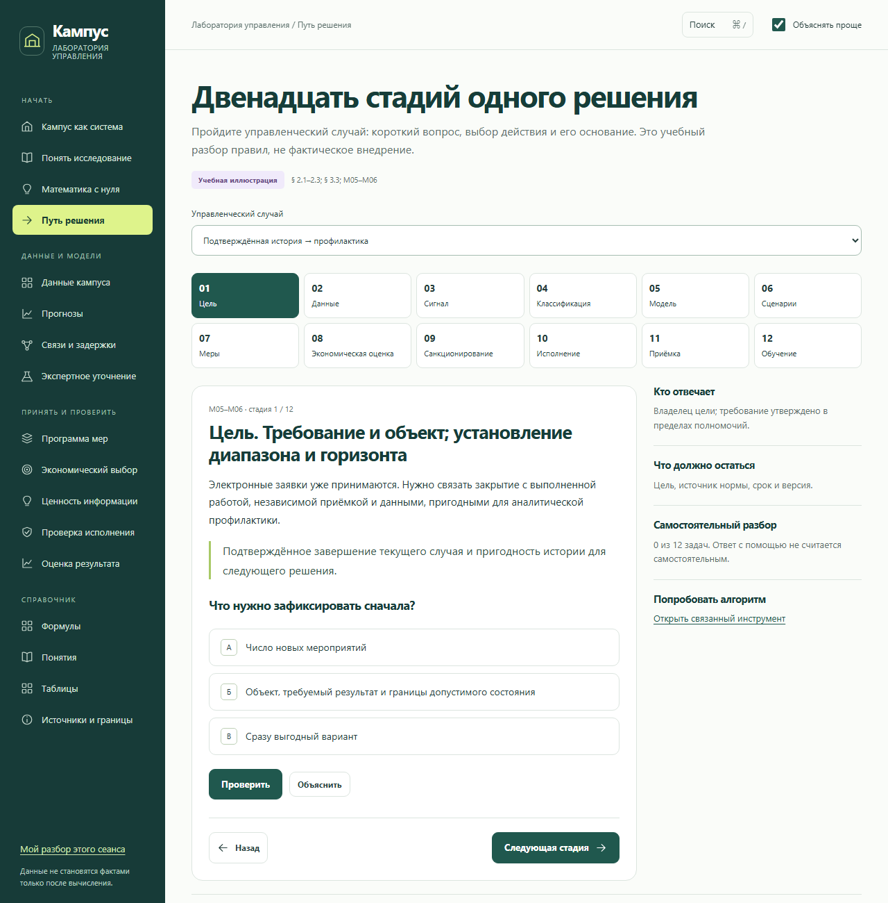
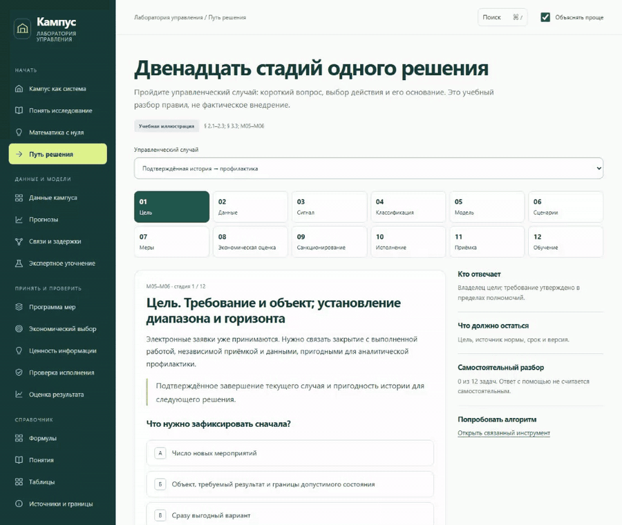
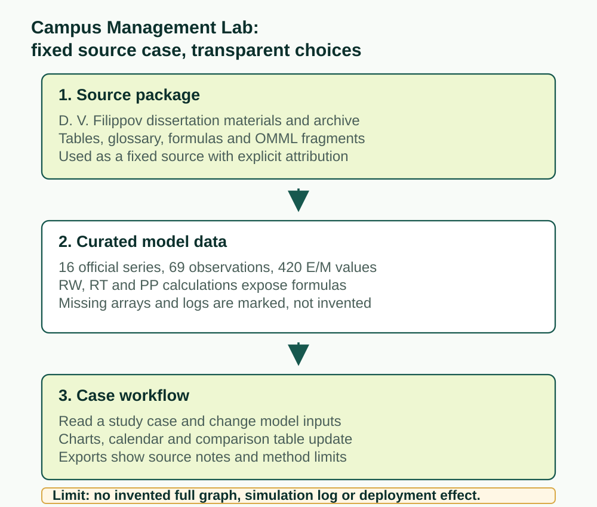
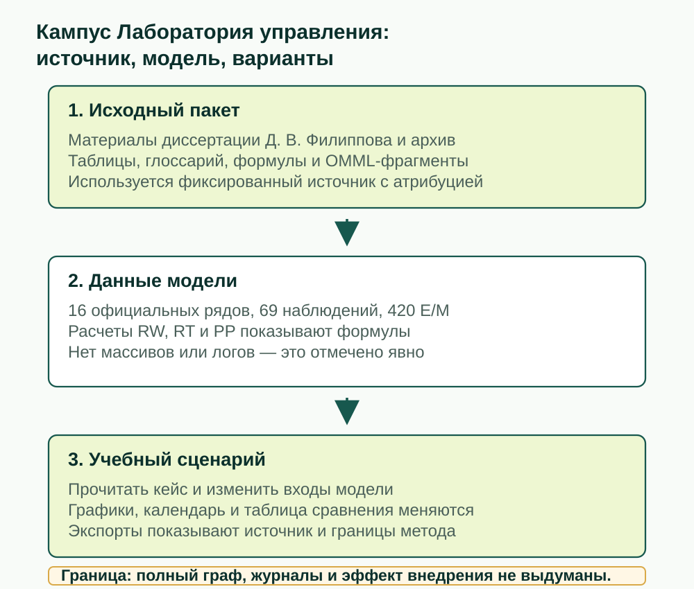

# Campus Management Lab

[English](#english) | [Русский](#русский)

Live site: <https://arseniy24rus.github.io/campus-management-lab/>

## English



*The application interface is currently Russian-only; the README is bilingual.*



*Demo: decision path, forecast input, calendar adjustment, and economics comparison.*



*Workflow diagram: fixed source package, curated model data, educational screens, and local checks.*

### Purpose

Campus Management Lab is a static educational and research companion for an adaptive-additive management case about university infrastructure. It is for readers who need to move from a dissertation chapter to a traceable browser exercise: read the study case, inspect the model inputs, compare alternatives, and see which values are source-backed, educational, or missing. It is not a campus digital twin, an operational planning system, or evidence that a real implementation would be economical.

### Workflow

The main user scenario follows a management decision. A learner opens the 12-stage case path, answers a short stage question, jumps to the relevant model, changes an input in the forecast page, then opens the program calendar or economics screen to compare admissible alternatives. The GIF shows exactly that rhythm: study case -> model inputs -> alternatives -> comparison result. Answers and settings live only in the current browser session. There is no account system, no backend database, no API key, no analytics tracker, and no required build step for publication.

### Data and methodology

The scientific source is D. V. Filippov, "Adaptive-additive system for managing the development of the social-infrastructure complex of a higher education institution", 2026, specialty 5.2.6 Management. The repository uses a provided manuscript and research archive as a fixed 2026 source package. [docs/SOURCES.md](docs/SOURCES.md) records the SHA-256 of the provided DOCX and archive, the observed layer, the expert/model layer, measure passports, formulas, and the material that could not be reconstructed. The full dissertation file and original archive are not embedded in the public site.

The data layer is intentionally explicit. It includes 16 official series with 69 observed values, 420 expert-model trajectory values, 12 measure passports, 35 source graph vertex names, 65 reference tables, 53 formulas, 24 math primers, nine explanatory readings, and 69 checked learning answers. Observed rows come from the dissertation's table P12.7; dashes remain missing values, not zeros. Expert/model values are kept separate from official observations. Four object correspondences were not reconstructed by number order. This is a limitation, not a gap filled by invention.

### Architecture

The computation layer lives in [js/math.js](js/math.js): RW, RT, and PP forecasts, mixture calculations, economics, information value, event traces, resource calendars, and validation helpers. [js/data.js](js/data.js) carries transferred source values, tables, quotes, and formulas. [js/content.js](js/content.js) provides the educational explanations and tasks. [js/formula-guides.js](js/formula-guides.js) explains symbols locally because the same letter can mean different things in different formulas. [js/views.js](js/views.js) composes screens, [js/ui.js](js/ui.js) renders UI and charts, and [js/app.js](js/app.js) handles routing and session behavior.

### Limits

The missing-data boundaries are non-negotiable. The provided archive did not contain the full 307-edge graph, the exact rational certificate of 140 inequalities, the complete log of 115,978 events, the source 360-value comparison panel, or the array of 300 simulation repetitions. Their published characteristics may appear as references, but the platform does not claim to reproduce those experiments. The small graph, short traces, and A-E alternatives are educational implementations based on described rules. A measure passport is not a measured effect or a real budget authorization.

### Local usage

Run the static app with any simple server, or open `index.html` when the browser permits local scripts. Mathematical checks require only Node 18+:

```bash
python -m http.server 8000
npm test
```

`npm test` runs [tests/math.test.cjs](tests/math.test.cjs). The release validation in [docs/VALIDATION.md](docs/VALIDATION.md) reports 5,866 mathematical assertions, browser checks for 187 routes, 69 learning answers, exported CSV/JSON files, responsive widths, keyboard checks, search, dialogs, and no application network requests. [docs/COVERAGE.md](docs/COVERAGE.md) maps screens to dissertation sections and reconstructed boundaries. Current README visuals were recorded from the real static app with Playwright.

### Rights and attribution

Rights and attribution are conservative. Texts, formulas, and data are not relicensed as open material by this repository. Public placement of unpublished fragments should be approved by the rights holder. Cite D. V. Filippov and the fixed 2026 source package when discussing the research basis, and cite this repository only for the browser educational implementation and its explicitly documented calculations.

<details>
<summary>Publication notes retained from the previous README</summary>

Publish the repository root through GitHub Pages: `index.html` should sit beside `assets/`, `js/`, `data/`, `docs/`, and `tests/`. Choose Settings -> Pages -> Deploy from a branch -> `main` or the actual branch -> `/(root)`. The `.nojekyll` file is included. Routes use `#/...`, and paths are relative, so the repository name does not need to be edited.

</details>

## Русский


*Интерфейс приложения сейчас русскоязычный; README двуязычный.*


*Демонстрация: путь решения, вход прогноза, настройка календаря и экономическое сравнение.*



*Схема: фиксированный исходный пакет, подготовленные модельные данные, учебные экраны и локальные проверки.*

### Назначение

Campus Management Lab - статический образовательный и исследовательский спутник кейса об адаптивно-аддитивном управлении университетской инфраструктурой. Он нужен читателю, который хочет пройти от главы диссертации к проверяемому браузерному упражнению: прочитать учебный случай, увидеть входы модели, сравнить альтернативы и понять, какие значения взяты из источника, какие являются учебными, а какие отсутствуют. Это не цифровой двойник кампуса, не промышленная система планирования и не доказательство экономической эффективности реального внедрения.

### Сценарий

Основной пользовательский сценарий идёт по управленческому решению. Ученик открывает путь из 12 стадий, отвечает на короткий вопрос, переходит к связанной модели, меняет вход на странице прогноза, затем открывает календарь программы или экономический экран, чтобы сравнить допустимые альтернативы. GIF показывает именно этот ритм: учебный кейс -> входы модели -> варианты -> результат сравнения. Ответы и настройки живут только в текущем сеансе браузера. Аккаунтов, серверной базы, API-ключей, аналитического трекера и обязательной сборки для публикации нет.

### Данные и методика

Научная основа - Д. В. Филиппов, «Адаптивно-аддитивная система управления развитием социально-инфраструктурного комплекса высшего учебного заведения», 2026, специальность 5.2.6 «Менеджмент». Репозиторий использует предоставленные рукопись и исследовательский архив как фиксированный исходный пакет 2026 года. [docs/SOURCES.md](docs/SOURCES.md) фиксирует SHA-256 DOCX и архива, наблюдаемый слой, экспертно-модельный слой, паспорта мер, формулы и материалы, которые не удалось восстановить. Полный файл диссертации и исходный архив в публичный сайт не вложены.

Слой данных сделан явным. Включены 16 официальных рядов с 69 наблюдаемыми значениями, 420 экспертно-модельных значений, 12 паспортов мер, 35 исходных названий вершин графа, 65 справочных таблиц, 53 формулы, 24 математические основы, девять разборов и 69 проверяемых учебных ответов. Наблюдения перенесены из таблицы П12.7; прочерки сохранены как отсутствующие значения, а не нули. E/M-траектории отделены от официальных наблюдений. Четыре объектных соответствия не восстановлены по порядку номеров. Это ограничение, а не место для произвольного заполнения.

### Архитектура

Расчёты находятся в [js/math.js](js/math.js): RW, RT и PP-прогнозы, смеси, экономика, ценность информации, событийные трассы, календарь ресурсов и проверки. [js/data.js](js/data.js) хранит перенесённые значения, таблицы, цитаты и формулы. [js/content.js](js/content.js) даёт учебные объяснения и задания. [js/formula-guides.js](js/formula-guides.js) объясняет символы локально, потому что одна и та же буква может иметь разные смыслы в разных формулах. [js/views.js](js/views.js) собирает экраны, [js/ui.js](js/ui.js) рисует интерфейс и графики, [js/app.js](js/app.js) управляет маршрутом и сеансом.

### Ограничения

Границы отсутствующих данных принципиальны. В архиве не было полного графа из 307 базовых рёбер, точного рационального сертификата из 140 неравенств, полного журнала 115 978 событий, исходной панели 360 значений и массива 300 имитационных повторов. Их опубликованные характеристики могут показываться как справка, но платформа не заявляет повторение этих экспериментов. Малый граф, короткие трассы и альтернативы A-E - учебные реализации по описанным правилам. Паспорт меры не является измеренным эффектом или реальным бюджетным разрешением.

### Локальный запуск

Запуск статического приложения возможен через простой сервер или прямое открытие `index.html`, если браузер разрешает локальные скрипты. Математические проверки требуют только Node 18+:

```bash
python -m http.server 8000
npm test
```

`npm test` запускает [tests/math.test.cjs](tests/math.test.cjs). В [docs/VALIDATION.md](docs/VALIDATION.md) зафиксированы 5866 математических проверок, браузерные проходы по 187 маршрутам, 69 учебных ответов, выгрузки CSV/JSON, адаптивные ширины, клавиатура, поиск, диалоги и отсутствие сетевых запросов приложения. [docs/COVERAGE.md](docs/COVERAGE.md) связывает экраны с разделами диссертации и границами восстановления. Визуалы README записаны Playwright с настоящего статического приложения.

### Права и атрибуция

Права и атрибуция трактуются осторожно. Тексты, формулы и данные не переобъявлены открытыми материалами этим репозиторием. Публичное размещение неопубликованных фрагментов следует согласовать с правообладателем. При обсуждении научной основы нужно ссылаться на Д. В. Филиппова и фиксированный исходный пакет 2026 года, а этот репозиторий цитировать как браузерную образовательную реализацию с явно описанными расчётами.

<details>
<summary>Сохранённые заметки о публикации</summary>

Публикуйте корень репозитория через GitHub Pages: `index.html` должен лежать рядом с `assets/`, `js/`, `data/`, `docs/` и `tests/`. В настройках выберите Settings -> Pages -> Deploy from a branch -> `main` или фактическую ветку -> `/(root)`. Файл `.nojekyll` уже включён. Маршруты используют `#/...`, пути относительные, поэтому имя репозитория менять в коде не нужно.

</details>
